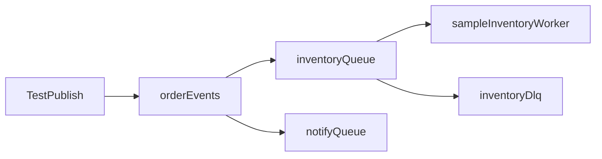

# SQS, SNS, and event-driven architecture

**Handout.** Region: **ap-south-1** (Mumbai).

You split inventory and notification off the HTTP request. You create topic `order-events`, queues `inventory-queue`, `notify-queue`, and `inventory-dlq`, and function `sample-inventory-worker`.

## Goals

By the end of this handout you can explain:

1. Why Sample Orders publishes an order event instead of doing inventory and email inside the HTTP request.
2. How to configure a standard queue: visibility timeout, long polling, and a dead-letter queue.
3. How one publish to an SNS topic fans out to two queues.
4. How a queue connects to a Lambda consumer, and what “at least once” requires of that code.

## Messaging and asynchronous communication

The order function returns an order id and stops. A real create-order path also updates inventory and notifies the customer. Doing both inside the HTTP request couples the API’s latency and its success to those two systems. If email is slow, the client waits. If email is down, the order fails even though the row could have been stored.

Asynchronous communication splits that work. `sample-create-order` stores what it must store and publishes a small event. Other components consume the event later. The client gets 201 when the order is accepted, not when the email is delivered.

Tradeoffs:

- The system is **eventually consistent**. For a moment, the order exists and the inventory worker has not run.
- Delivery in this design is **at least once**. A consumer can see the same event twice. The worker must tolerate that. Using `orderId` as an idempotency key is the application’s job. SQS does not do it for a standard queue.
- The event is small. The SQS limit is **256 KB** per message. The event carries `orderId`, `sku`, and `qty`. The invoice PDF stays in S3.

Synchronous calls still have a place. The client’s `POST /orders` is synchronous. The call from the worker to Aurora can be synchronous inside that worker. “Event-driven” describes the seam between services, not every line of code.

## Amazon SQS

A queue stores messages until a consumer deletes them. Sample Orders uses **standard** queues, not FIFO. Standard queues offer at-least-once delivery and best-effort ordering. That fits two independent consumers. **FIFO** queues (name ends in `.fifo`) preserve order inside a message group and support content-based deduplication. Use FIFO when two inventory updates for the same SKU must not run in parallel. This example stays on standard queues.

| Setting | Value | Why |
| --- | --- | --- |
| Visibility timeout | 30 seconds | After a receive, other consumers cannot see the message. If the worker crashes, the message returns when the timeout ends. The timeout must be longer than the function. A 3-second function with a 30-second visibility timeout will not be handed the same message while it is still running. |
| Long polling | 20 seconds | `ReceiveMessage` waits for a message instead of returning empty responses. Fewer empty polls, lower cost, faster pickup when a message arrives. |
| Retention | 4 days (the default is fine) | How long an unprocessed message stays. Not the same as visibility. |
| Dead-letter queue | `inventory-dlq`, max receive count 3 | A poison message is received and not deleted three times, then moved. The main queue does not retry it forever. `notify-queue` can live without a DLQ. `inventory-queue` gets one because a bad inventory event should be inspectable. |

Lambda’s SQS event source mapping polls the queue, invokes the function with a batch of `Records`, and deletes the messages when the function succeeds. If the function throws, the message becomes visible again after the visibility timeout, and the receive count increases. You do not write a delete call in the stub worker.

The function’s role needs `sqs:ReceiveMessage`, `sqs:DeleteMessage`, and `sqs:GetQueueAttributes` on `inventory-queue`. The console’s “SQS trigger” path can add a policy. Read what it added. It should name that queue, not `*`.

## Amazon SNS

SNS is a topic. Publishers send one message. SNS delivers a copy to each subscription. Sample’s topic is `order-events`. Subscriptions here are the two SQS queues. Other subscription types exist (email, Lambda, HTTPS). An email subscription waits on a confirmation click. An SQS subscription is enough to see fan-out.

Fan-out is the reason for the topic. If `sample-create-order` wrote to each queue itself, every new consumer would require a code change. With SNS, a new subscriber is a subscription. The publisher still calls `sns:Publish` once.

SNS to SQS needs permission on the queue policy for `sns.amazonaws.com` to `sqs:SendMessage`, with a condition that the source is `order-events`. The console subscription dialog can add this statement. If messages never arrive, that policy is the first place to look. The topic published successfully. The queue refused the copy.

Raw message delivery, if enabled, puts the payload in the SQS body as the publisher sent it. With raw delivery off, the body is an SNS envelope and the order JSON is inside the `Message` string. Leave raw delivery off and print the body so you can see the envelope. The order JSON is the `Message` field.

## Event-driven integration



The test publish stands in for `sample-create-order`. The real function would call `sns:Publish` after it accepted the order. You do not need to rebuild the HTTP API to see fan-out.

You do not create `sample-notify-worker`. `notify-queue` still receives a copy, which you see by polling the queue in the console. One Lambda is enough to show the trigger. The second worker is the same pattern with a different queue.

Failure path:

- Worker throws → message returns → after 3 receives it sits on `inventory-dlq`.
- An alarm on that queue is a monitoring concern: `ApproximateNumberOfMessagesVisible` on the DLQ greater than zero.
- Duplicate delivery → the worker must treat a repeated `orderId` as already done.

```python
def lambda_handler(event, context):
    for record in event.get("Records", []):
        print(record.get("body"))
    return {"processed": len(event.get("Records", []))}
```

## In the console

### 1. Create the dead-letter queue

1. Region **ap-south-1**. **SQS** → **Create queue**.
2. Type **Standard**. Name `inventory-dlq`.
3. Leave the other defaults. Create the queue.

### 2. Create the two work queues

1. Create standard queue `inventory-queue`.
2. Visibility timeout **30** seconds. Receive message wait time **20** seconds.
3. Dead-letter queue: enabled. Choose `inventory-dlq`. Maximum receives **3**.
4. Create standard queue `notify-queue` with the same visibility and wait time. No dead-letter queue.

### 3. Create the topic and subscribe both queues

1. **SNS** → **Topics** → **Create topic**. Standard. Name `order-events`.
2. Create a subscription. Protocol **Amazon SQS**. Endpoint `inventory-queue`. Leave raw message delivery off. Allow the console to set the queue policy.
3. Create a second subscription for `notify-queue`.

**Expected:** the topic shows two confirmed subscriptions. SQS protocols confirm immediately.

**If a subscription stays pending:** it is an email subscription. Delete it and subscribe the queue.

### 4. Create the worker and the trigger

1. Lambda → create `sample-inventory-worker`, Python 3.12, new role with basic execution plus the SQS permissions the trigger offers.
2. Deploy the worker code above. Timeout 3 seconds.
3. Add a trigger. Source **SQS**, queue `inventory-queue`, batch size **1**.

**Expected:** the function’s configuration shows the SQS trigger. The role policy names `inventory-queue`.

### 5. Publish one event

1. SNS → `order-events` → **Publish message**.
2. Body:

```json
{"orderId":"ord-1001","sku":"BOOK-1","qty":1}
```

3. Publish.
4. SQS → `notify-queue` → **Send and receive messages** → **Poll for messages**. You should see one message. Read the envelope before you delete it.
5. Lambda → `sample-inventory-worker` → Monitor → View CloudWatch logs. The newest stream contains the body.

**Expected:** both queues received a copy. The worker logged the inventory copy. `inventory-dlq` is empty.

**If the worker log is empty:** the queue policy does not allow SNS, or the trigger is on the wrong queue. Check `inventory-queue`’s access policy for `sns:SendMessage`, then check the trigger.

**If only one queue has the message:** the other subscription is missing. Add it and publish again. The first message is not replayed.

## When you are done

1. Delete the Lambda trigger, the function `sample-inventory-worker`, and its role.
2. Delete both SNS subscriptions, then the topic `order-events`.
3. Delete `inventory-queue`, `notify-queue`, and `inventory-dlq`. Delete the source queue before the DLQ if the console complains.
4. Delete the worker’s log group.

Stay on standard queues. A FIFO queue adds naming and deduplication you do not need to see fan-out. An email or SMS subscription is unnecessary.

## What this costs

SQS and SNS request volume for a few test messages sits inside the free tier for a normal account. Delete the queues and the function so a trigger does not keep polling an abandoned queue. An orphaned function makes later logs hard to read.
